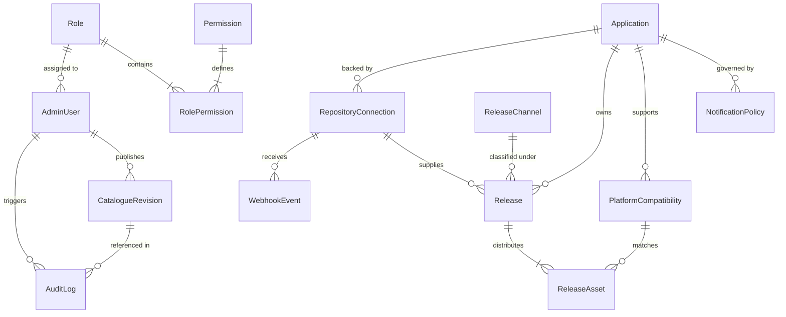

# HENU Platform API - Database Design Specification

**Document Version:** 1.0.0  
**Target RDBMS:** PostgreSQL 16+  
**ORM:** Prisma 5.x / 6.x  
**Author:** Principal Backend Architect, HENU OS PRIVATE LIMITED  

---

## 1. Design Principles & Conventions

1. **Primary Keys:** UUID v4 (`gen_random_uuid()` in PostgreSQL) across all business entities to prevent enumeration attacks and facilitate distributed record generation.
2. **Timestamps:** Every mutable entity includes `createdAt` and `updatedAt` (`TIMESTAMPTZ`), defaulting to `CURRENT_TIMESTAMP`.
3. **Soft Deletion:** Core master entities (`AdminUser`, `Application`, `RepositoryConnection`, `ReleaseChannel`) implement `deletedAt TIMESTAMPTZ NULL`. Hard deletes are prohibited on transactional and audit records.
4. **Relational Integrity:** Foreign keys enforce strict referential actions:
   - `ON DELETE RESTRICT` for financial, audit, catalog, and released artifacts to prevent orphan states.
   - `ON DELETE CASCADE` only for tightly coupled child composition tables (e.g., `RolePermission`, `PlatformCompatibility`).
5. **Audit Immutability:** `AuditLog` and `WebhookEvent` are strictly append-only.
6. **Case Sensitivity & Naming:** All identifiers use `snake_case` in PostgreSQL and `camelCase` in Prisma models via `@map` annotations.
7. **JSONB Usage:** Reserved for unstructured changelog payloads, GitHub webhook metadata, and platform-specific launch arguments, indexed with PostgreSQL GIN indexes where queried.

---

## 2. Entity-Relationship Diagram (ERD)



---

## 3. Detailed Data Dictionary

### 3.1 Identity, Access Control & Auditing

#### `AdminUser`
Stores authenticated administrative operators.
- `id` (UUID, PK): Unique identifier.
- `email` (VARCHAR(255), UNIQUE, NOT NULL): Administrator email address.
- `passwordHash` (VARCHAR(255), NOT NULL): Argon2id hashed credentials.
- `fullName` (VARCHAR(150), NOT NULL): Display name.
- `roleId` (UUID, FK -> `Role.id`, NOT NULL): Associated RBAC role.
- `isActive` (BOOLEAN, DEFAULT true, NOT NULL): Immediate suspension toggle.
- `mfaSecret` (VARCHAR(255), NULL): Encrypted TOTP secret.
- `mfaEnabled` (BOOLEAN, DEFAULT false, NOT NULL): MFA enforcement status.
- `refreshTokenHash` (VARCHAR(255), NULL): Hash of currently active refresh token for session revocation.
- `lastLoginAt` (TIMESTAMPTZ, NULL): Timestamp of most recent successful session.
- `failedLoginAttempts` (INT, DEFAULT 0, NOT NULL): Lockout counter.
- `lockedUntil` (TIMESTAMPTZ, NULL): Account lockout expiration.
- `createdAt` (TIMESTAMPTZ, DEFAULT NOW(), NOT NULL)
- `updatedAt` (TIMESTAMPTZ, DEFAULT NOW(), NOT NULL)
- `deletedAt` (TIMESTAMPTZ, NULL): Soft-deletion timestamp.

#### `Role` & `Permission`
Fine-grained access control model.
- `Role`:
  - `id` (UUID, PK)
  - `name` (VARCHAR(50), UNIQUE, NOT NULL): e.g., `SUPER_ADMIN`, `RELEASE_MANAGER`, `CATALOGUE_EDITOR`, `AUDITOR`.
  - `description` (TEXT, NULL)
  - `isSystem` (BOOLEAN, DEFAULT false, NOT NULL): Protects core roles from deletion.
  - `createdAt`, `updatedAt`, `deletedAt`
- `Permission`:
  - `id` (UUID, PK)
  - `code` (VARCHAR(80), UNIQUE, NOT NULL): Domain action identifier (e.g., `apps:create`, `releases:publish`, `catalogue:publish`, `audit:read`).
  - `category` (VARCHAR(50), NOT NULL): Module grouping (e.g., `APPLICATIONS`, `RELEASES`, `AUDIT`).
  - `description` (TEXT, NULL)
- `RolePermission` (Junction Table):
  - `roleId` (UUID, FK -> `Role.id`, ON DELETE CASCADE)
  - `permissionId` (UUID, FK -> `Permission.id`, ON DELETE CASCADE)
  - Composite PK: `(roleId, permissionId)`

#### `AuditLog`
Immutable administrative audit log.
- `id` (UUID, PK)
- `adminUserId` (UUID, FK -> `AdminUser.id`, ON DELETE SET NULL, NULL): Nullable to preserve logs if user record is anonymized.
- `actorEmail` (VARCHAR(255), NOT NULL): Preserved actor identity snapshot.
- `ipAddress` (VARCHAR(45), NOT NULL): IPv4/IPv6 client IP.
- `userAgent` (TEXT, NULL): HTTP Client User-Agent.
- `action` (VARCHAR(100), NOT NULL): Action identifier (e.g., `APPLICATION_CREATED`, `RELEASE_PROMOTED`, `CATALOGUE_PUBLISHED`).
- `entityType` (VARCHAR(60), NOT NULL): Target entity class (e.g., `Application`, `Release`).
- `entityId` (VARCHAR(64), NOT NULL): Identifier of modified record.
- `payload` (JSONB, NOT NULL): Structured before/after diff or snapshot.
- `createdAt` (TIMESTAMPTZ, DEFAULT NOW(), NOT NULL)
- **Index:** `idx_audit_entity (entityType, entityId)`, `idx_audit_created_at (createdAt DESC)`, `idx_audit_actor (adminUserId, createdAt DESC)`.

---

### 3.2 Application & Source Control Connection

#### `Application`
Core software package entry in the HENU ecosystem.
- `id` (UUID, PK)
- `slug` (VARCHAR(64), UNIQUE, NOT NULL): Lowercase URL/ID slug (e.g., `henu-pa`, `henu-ai`, `henu-ide`).
- `displayName` (VARCHAR(120), NOT NULL): Formal application title.
- `summary` (VARCHAR(255), NOT NULL): Short one-line description for Hub cards.
- `description` (TEXT, NOT NULL): Full Markdown/rich text application details.
- `category` (VARCHAR(50), NOT NULL): e.g., `PRODUCTIVITY`, `DEVELOPMENT`, `AI`, `UTILITIES`, `ENTERPRISE`.
- `developer` (VARCHAR(120), DEFAULT 'HENU OS PRIVATE LIMITED', NOT NULL)
- `iconUrl` (VARCHAR(512), NOT NULL): High-resolution application icon URL.
- `bannerUrl` (VARCHAR(512), NULL): Optional application showcase banner.
- `homepageUrl` (VARCHAR(512), NULL): Official product website.
- `docsUrl` (VARCHAR(512), NULL): Documentation URL.
- `license` (VARCHAR(60), DEFAULT 'Proprietary', NOT NULL)
- `status` (ENUM `ApplicationStatus`, DEFAULT 'DRAFT', NOT NULL): `DRAFT`, `ACTIVE`, `MAINTENANCE`, `DEPRECATED`, `ARCHIVED`.
- `featured` (BOOLEAN, DEFAULT false, NOT NULL): Priority flag for Hub showcase.
- `sortOrder` (INT, DEFAULT 0, NOT NULL): Display sequencing weight.
- `createdAt`, `updatedAt`, `deletedAt`
- **Indexes:** `idx_app_slug (slug)`, `idx_app_status (status)`, `idx_app_category (category)`.

#### `RepositoryConnection`
Bridge connecting an application to upstream GitHub repositories.
- `id` (UUID, PK)
- `applicationId` (UUID, FK -> `Application.id`, ON DELETE RESTRICT, NOT NULL)
- `provider` (VARCHAR(30), DEFAULT 'GITHUB', NOT NULL)
- `repoOwner` (VARCHAR(100), NOT NULL): GitHub organization or user account.
- `repoName` (VARCHAR(100), NOT NULL): GitHub repository name.
- `githubInstallationId` (BIGINT, NOT NULL): GitHub App tenant installation ID.
- `targetBranch` (VARCHAR(100), DEFAULT 'main', NOT NULL): Canonical branch for release tracking.
- `assetPattern` (VARCHAR(255), NOT NULL): Regex for identifying distribution assets (e.g., `.*\\.(exe|msi|dmg|AppImage|deb|rpm|zip)$`).
- `tagPattern` (VARCHAR(255), DEFAULT '^v?[0-9]+\\.[0-9]+\\.[0-9]+', NOT NULL): Regex for Semver tag parsing.
- `autoIngestReleases` (BOOLEAN, DEFAULT true, NOT NULL): Enable automatic webhook processing.
- `autoPublishChannels` (VARCHAR(50)[], DEFAULT '{}', NOT NULL): Channels permitted to auto-publish without manual admin review (e.g., `['NIGHTLY']`).
- `isActive` (BOOLEAN, DEFAULT true, NOT NULL)
- `createdAt`, `updatedAt`, `deletedAt`
- **Unique Constraint:** `(repoOwner, repoName)` (A GitHub repository can only be linked to one Application connection).
- **Index:** `idx_repo_conn_lookup (repoOwner, repoName, isActive)`.

---

### 3.3 Releases, Assets & Compatibility

#### `ReleaseChannel`
Configurable distribution tiers.
- `id` (UUID, PK)
- `name` (VARCHAR(40), UNIQUE, NOT NULL): e.g., `STABLE`, `BETA`, `NIGHTLY`.
- `description` (TEXT, NULL)
- `autoPromoteRule` (JSONB, NULL): Automation criteria (e.g., min days in Beta, zero critical bugs).
- `isDefault` (BOOLEAN, DEFAULT false, NOT NULL)
- `createdAt`, `updatedAt`

#### `PlatformCompatibility`
Defines operating system and architecture matrix supported by an Application.
- `id` (UUID, PK)
- `applicationId` (UUID, FK -> `Application.id`, ON DELETE CASCADE, NOT NULL)
- `os` (ENUM `OperatingSystem`, NOT NULL): `WINDOWS`, `MACOS`, `LINUX`.
- `arch` (ENUM `CpuArchitecture`, NOT NULL): `X86_64`, `ARM64`, `UNIVERSAL`.
- `packageFormat` (ENUM `PackageFormat`, NOT NULL): `EXE`, `MSI`, `DMG`, `PKG`, `APPIMAGE`, `DEB`, `RPM`, `TAR_GZ`, `ZIP`.
- `minOsVersion` (VARCHAR(30), NULL): e.g., `Windows 10 21H2`, `macOS 12.0 Monterey`, `Ubuntu 22.04 LTS`.
- `maxOsVersion` (VARCHAR(30), NULL)
- `launchExecutableName` (VARCHAR(120), NULL): Default binary name invoked by HUB launcher.
- `installInstructions` (TEXT, NULL)
- `isSupported` (BOOLEAN, DEFAULT true, NOT NULL)
- `createdAt`, `updatedAt`
- **Unique Constraint:** `(applicationId, os, arch, packageFormat)`

#### `Release`
Versioned release artifact of an Application.
- `id` (UUID, PK)
- `applicationId` (UUID, FK -> `Application.id`, ON DELETE RESTRICT, NOT NULL)
- `repositoryConnectionId` (UUID, FK -> `RepositoryConnection.id`, ON DELETE RESTRICT, NOT NULL)
- `channelId` (UUID, FK -> `ReleaseChannel.id`, ON DELETE RESTRICT, NOT NULL)
- `version` (VARCHAR(50), NOT NULL): Normalized semver string (e.g., `1.4.0`).
- `semverMajor` (INT, NOT NULL)
- `semverMinor` (INT, NOT NULL)
- `semverPatch` (INT, NOT NULL)
- `semverPrerelease` (VARCHAR(50), NULL): e.g., `beta.1`, `nightly.20261119`.
- `tagName` (VARCHAR(100), NOT NULL): Raw GitHub Git tag (e.g., `v1.4.0`).
- `gitCommitSha` (VARCHAR(40), NOT NULL): Exact commit hash of the release.
- `title` (VARCHAR(255), NOT NULL): Release title.
- `changelog` (TEXT, NOT NULL): Markdown release notes.
- `githubReleaseId` (BIGINT, UNIQUE, NOT NULL): Upstream GitHub Release ID.
- `githubPublishedAt` (TIMESTAMPTZ, NOT NULL): Upstream publication time.
- `isPrerelease` (BOOLEAN, DEFAULT false, NOT NULL)
- `status` (ENUM `ReleaseStatus`, DEFAULT 'DRAFT', NOT NULL): `DRAFT`, `VALIDATED`, `PUBLISHED`, `REVOKED`.
- `publishedAt` (TIMESTAMPTZ, NULL): Platform publication timestamp.
- `revocationReason` (TEXT, NULL): Reason for emergency revocation if revoked.
- `createdAt`, `updatedAt`
- **Unique Constraint:** `(applicationId, channelId, version)`
- **Indexes:** `idx_release_app_channel (applicationId, channelId, status)`, `idx_release_semver (applicationId, semverMajor DESC, semverMinor DESC, semverPatch DESC)`.

#### `ReleaseAsset`
Physical downloadable binary assets attached to a Release.
- `id` (UUID, PK)
- `releaseId` (UUID, FK -> `Release.id`, ON DELETE CASCADE, NOT NULL)
- `platformCompatibilityId` (UUID, FK -> `PlatformCompatibility.id`, ON DELETE RESTRICT, NULL): Matched compatibility profile.
- `githubAssetId` (BIGINT, UNIQUE, NOT NULL): Upstream GitHub Asset ID.
- `fileName` (VARCHAR(255), NOT NULL): e.g., `HENU-PA-Setup-1.4.0.exe`.
- `downloadUrl` (VARCHAR(1024), NOT NULL): Direct GitHub releases download URL.
- `sizeBytes` (BIGINT, NOT NULL): Exact byte count.
- `contentType` (VARCHAR(120), NOT NULL): MIME type (e.g., `application/octet-stream`).
- `sha256` (VARCHAR(64), NOT NULL): Cryptographic SHA-256 hex digest.
- `signatureUrl` (VARCHAR(1024), NULL): Optional external signature file URL (.sig/.asc).
- `isInstallable` (BOOLEAN, DEFAULT false, NOT NULL): Set to true only if passed platform verification.
- `verificationStatus` (ENUM `AssetVerificationStatus`, DEFAULT 'PENDING', NOT NULL): `PENDING`, `VERIFIED`, `REJECTED`.
- `verificationError` (TEXT, NULL)
- `createdAt`, `updatedAt`
- **Index:** `idx_asset_release (releaseId, isInstallable)`.

---

### 3.4 Catalogue, Ingress & Notification Policies

#### `CatalogueRevision`
Immutable point-in-time public catalog manifests.
- `id` (UUID, PK)
- `revisionNumber` (INT, UNIQUE, NOT NULL): Monotonically increasing revision counter.
- `publishedByAdminId` (UUID, FK -> `AdminUser.id`, ON DELETE SET NULL, NULL)
- `contentHash` (VARCHAR(64), NOT NULL): SHA-256 hash of the generated catalog JSON manifest.
- `manifestPayload` (JSONB, NOT NULL): Full compiled catalog document consumed by clients.
- `applicationCount` (INT, NOT NULL)
- `releaseCount` (INT, NOT NULL)
- `summary` (VARCHAR(255), NOT NULL): e.g., "Published HENU AI v1.2.0 to Stable".
- `isActive` (BOOLEAN, DEFAULT true, NOT NULL): Current live pointer.
- `publishedAt` (TIMESTAMPTZ, DEFAULT NOW(), NOT NULL)
- **Index:** `idx_catalog_active (isActive)`, `idx_catalog_revision (revisionNumber DESC)`.

#### `WebhookEvent`
Ingress audit, idempotency, and asynchronous worker queue tracker.
- `id` (UUID, PK)
- `deliveryId` (VARCHAR(64), UNIQUE, NOT NULL): `X-GitHub-Delivery` GUID from GitHub.
- `eventType` (VARCHAR(60), NOT NULL): e.g., `release`, `release_asset`.
- `repositoryConnectionId` (UUID, FK -> `RepositoryConnection.id`, ON DELETE SET NULL, NULL)
- `status` (ENUM `WebhookStatus`, DEFAULT 'RECEIVED', NOT NULL): `RECEIVED`, `PROCESSING`, `PROCESSED`, `IGNORED`, `FAILED`.
- `payload` (JSONB, NOT NULL): Raw webhook payload.
- `attemptCount` (INT, DEFAULT 0, NOT NULL)
- `lastError` (TEXT, NULL)
- `processedAt` (TIMESTAMPTZ, NULL)
- `createdAt` (TIMESTAMPTZ, DEFAULT NOW(), NOT NULL)
- **Index:** `idx_webhook_delivery (deliveryId)`, `idx_webhook_status (status, createdAt)`.

#### `NotificationPolicy`
Thresholds and rules for triggering notifications to clients and administrators.
- `id` (UUID, PK)
- `applicationId` (UUID, FK -> `Application.id`, ON DELETE CASCADE, NULL): Global policy if NULL.
- `eventTrigger` (VARCHAR(80), NOT NULL): e.g., `RELEASE_PUBLISHED`, `SECURITY_REVOCATION`, `WEBHOOK_FAILURE`.
- `channel` (ENUM `NotificationChannel`, NOT NULL): `SSE_HUB`, `SSE_ADMIN`, `EMAIL`, `WEBHOOK_OUTBOUND`.
- `targetDestination` (VARCHAR(255), NULL): Email recipient or target webhook URL.
- `isEnabled` (BOOLEAN, DEFAULT true, NOT NULL)
- `config` (JSONB, NULL): Custom filters (e.g., minimum severity, specific release channel).
- `createdAt`, `updatedAt`

---

## 4. Prisma Schema Definition (`prisma/schema.prisma`)

```prisma
datasource db {
  provider = "postgresql"
  url      = env("DATABASE_URL")
}

generator client {
  provider = "prisma-client-js"
}

// ----------------------------------------------------
// ENUMS
// ----------------------------------------------------

enum ApplicationStatus {
  DRAFT
  ACTIVE
  MAINTENANCE
  DEPRECATED
  ARCHIVED
}

enum OperatingSystem {
  WINDOWS
  MACOS
  LINUX
}

enum CpuArchitecture {
  X86_64
  ARM64
  UNIVERSAL
}

enum PackageFormat {
  EXE
  MSI
  DMG
  PKG
  APPIMAGE
  DEB
  RPM
  TAR_GZ
  ZIP
}

enum ReleaseStatus {
  DRAFT
  VALIDATED
  PUBLISHED
  REVOKED
}

enum AssetVerificationStatus {
  PENDING
  VERIFIED
  REJECTED
}

enum WebhookStatus {
  RECEIVED
  PROCESSING
  PROCESSED
  IGNORED
  FAILED
}

enum NotificationChannel {
  SSE_HUB
  SSE_ADMIN
  EMAIL
  WEBHOOK_OUTBOUND
}

// ----------------------------------------------------
// IDENTITY & ACCESS CONTROL
// ----------------------------------------------------

model AdminUser {
  id                 String              @id @default(dbgenerated("gen_random_uuid()")) @db.Uuid
  email              String              @unique @db.VarChar(255)
  passwordHash       String              @map("password_hash") @db.VarChar(255)
  fullName           String              @map("full_name") @db.VarChar(150)
  roleId             String              @map("role_id") @db.Uuid
  role               Role                @relation(fields: [roleId], references: [id], onDelete: Restrict)
  isActive           Boolean             @default(true) @map("is_active")
  mfaSecret          String?             @map("mfa_secret") @db.VarChar(255)
  mfaEnabled         Boolean             @default(false) @map("mfa_enabled")
  refreshTokenHash   String?             @map("refresh_token_hash") @db.VarChar(255)
  lastLoginAt        DateTime?           @map("last_login_at") @db.Timestamptz
  failedLoginAttempts Int                @default(0) @map("failed_login_attempts")
  lockedUntil        DateTime?           @map("locked_until") @db.Timestamptz
  createdAt          DateTime            @default(now()) @map("created_at") @db.Timestamptz
  updatedAt          DateTime            @updatedAt @map("updated_at") @db.Timestamptz
  deletedAt          DateTime?           @map("deleted_at") @db.Timestamptz

  auditLogs          AuditLog[]
  catalogRevisions   CatalogueRevision[]

  @@map("admin_users")
  @@index([roleId])
}

model Role {
  id          String           @id @default(dbgenerated("gen_random_uuid()")) @db.Uuid
  name        String           @unique @db.VarChar(50)
  description String?          @db.Text
  isSystem    Boolean          @default(false) @map("is_system")
  createdAt   DateTime         @default(now()) @map("created_at") @db.Timestamptz
  updatedAt   DateTime         @updatedAt @map("updated_at") @db.Timestamptz
  deletedAt   DateTime?        @map("deleted_at") @db.Timestamptz

  users       AdminUser[]
  permissions RolePermission[]

  @@map("roles")
}

model Permission {
  id          String           @id @default(dbgenerated("gen_random_uuid()")) @db.Uuid
  code        String           @unique @db.VarChar(80)
  category    String           @db.VarChar(50)
  description String?          @db.Text

  roles       RolePermission[]

  @@map("permissions")
}

model RolePermission {
  roleId       String     @map("role_id") @db.Uuid
  permissionId String     @map("permission_id") @db.Uuid
  role         Role       @relation(fields: [roleId], references: [id], onDelete: Cascade)
  permission   Permission @relation(fields: [permissionId], references: [id], onDelete: Cascade)

  @@id([roleId, permissionId])
  @@map("role_permissions")
}

model AuditLog {
  id          String     @id @default(dbgenerated("gen_random_uuid()")) @db.Uuid
  adminUserId String?    @map("admin_user_id") @db.Uuid
  adminUser   AdminUser? @relation(fields: [adminUserId], references: [id], onDelete: SetNull)
  actorEmail  String     @map("actor_email") @db.VarChar(255)
  ipAddress   String     @map("ip_address") @db.VarChar(45)
  userAgent   String?    @map("user_agent") @db.Text
  action      String     @db.VarChar(100)
  entityType  String     @map("entity_type") @db.VarChar(60)
  entityId    String     @map("entity_id") @db.VarChar(64)
  payload     Json       @db.JsonB
  createdAt   DateTime   @default(now()) @map("created_at") @db.Timestamptz

  @@map("audit_logs")
  @@index([entityType, entityId])
  @@index([createdAt(sort: Desc)])
  @@index([adminUserId, createdAt(sort: Desc)])
}

// ----------------------------------------------------
// APPLICATION & REPOSITORY CONNECTIONS
// ----------------------------------------------------

model Application {
  id              String                  @id @default(dbgenerated("gen_random_uuid()")) @db.Uuid
  slug            String                  @unique @db.VarChar(64)
  displayName     String                  @map("display_name") @db.VarChar(120)
  summary         String                  @db.VarChar(255)
  description     String                  @db.Text
  category        String                  @db.VarChar(50)
  developer       String                  @default("HENU OS PRIVATE LIMITED") @db.VarChar(120)
  iconUrl         String                  @map("icon_url") @db.VarChar(512)
  bannerUrl       String?                 @map("banner_url") @db.VarChar(512)
  homepageUrl     String?                 @map("homepage_url") @db.VarChar(512)
  docsUrl         String?                 @map("docs_url") @db.VarChar(512)
  license         String                  @default("Proprietary") @db.VarChar(60)
  status          ApplicationStatus       @default(DRAFT)
  featured        Boolean                 @default(false)
  sortOrder       Int                     @default(0) @map("sort_order")
  createdAt       DateTime                @default(now()) @map("created_at") @db.Timestamptz
  updatedAt       DateTime                @updatedAt @map("updated_at") @db.Timestamptz
  deletedAt       DateTime?               @map("deleted_at") @db.Timestamptz

  connections     RepositoryConnection[]
  compatibilities PlatformCompatibility[]
  releases        Release[]
  notifications   NotificationPolicy[]

  @@map("applications")
  @@index([slug])
  @@index([status])
  @@index([category])
}

model RepositoryConnection {
  id                   String        @id @default(dbgenerated("gen_random_uuid()")) @db.Uuid
  applicationId        String        @map("application_id") @db.Uuid
  application          Application   @relation(fields: [applicationId], references: [id], onDelete: Restrict)
  provider             String        @default("GITHUB") @db.VarChar(30)
  repoOwner            String        @map("repo_owner") @db.VarChar(100)
  repoName             String        @map("repo_name") @db.VarChar(100)
  githubInstallationId BigInt        @map("github_installation_id")
  targetBranch         String        @default("main") @map("target_branch") @db.VarChar(100)
  assetPattern         String        @map("asset_pattern") @db.VarChar(255)
  tagPattern           String        @default("^v?[0-9]+\\.[0-9]+\\.[0-9]+") @map("tag_pattern") @db.VarChar(255)
  autoIngestReleases   Boolean       @default(true) @map("auto_ingest_releases")
  autoPublishChannels  String[]      @default([]) @map("auto_publish_channels")
  isActive             Boolean       @default(true) @map("is_active")
  createdAt            DateTime      @default(now()) @map("created_at") @db.Timestamptz
  updatedAt            DateTime      @updatedAt @map("updated_at") @db.Timestamptz
  deletedAt            DateTime?     @map("deleted_at") @db.Timestamptz

  releases             Release[]
  webhookEvents        WebhookEvent[]

  @@unique([repoOwner, repoName])
  @@map("repository_connections")
  @@index([applicationId])
  @@index([repoOwner, repoName, isActive])
}

// ----------------------------------------------------
// RELEASES, ASSETS & COMPATIBILITY
// ----------------------------------------------------

model ReleaseChannel {
  id             String    @id @default(dbgenerated("gen_random_uuid()")) @db.Uuid
  name           String    @unique @db.VarChar(40)
  description    String?   @db.Text
  autoPromoteRule Json?    @map("auto_promote_rule") @db.JsonB
  isDefault      Boolean   @default(false) @map("is_default")
  createdAt      DateTime  @default(now()) @map("created_at") @db.Timestamptz
  updatedAt      DateTime  @updatedAt @map("updated_at") @db.Timestamptz

  releases       Release[]

  @@map("release_channels")
}

model PlatformCompatibility {
  id                    String          @id @default(dbgenerated("gen_random_uuid()")) @db.Uuid
  applicationId         String          @map("application_id") @db.Uuid
  application           Application     @relation(fields: [applicationId], references: [id], onDelete: Cascade)
  os                    OperatingSystem
  arch                  CpuArchitecture
  packageFormat         PackageFormat   @map("package_format")
  minOsVersion          String?         @map("min_os_version") @db.VarChar(30)
  maxOsVersion          String?         @map("max_os_version") @db.VarChar(30)
  launchExecutableName  String?         @map("launch_executable_name") @db.VarChar(120)
  installInstructions  String?         @map("install_instructions") @db.Text
  isSupported           Boolean         @default(true) @map("is_supported")
  createdAt             DateTime        @default(now()) @map("created_at") @db.Timestamptz
  updatedAt             DateTime        @updatedAt @map("updated_at") @db.Timestamptz

  assets                ReleaseAsset[]

  @@unique([applicationId, os, arch, packageFormat])
  @@map("platform_compatibilities")
  @@index([applicationId, isSupported])
}

model Release {
  id                     String               @id @default(dbgenerated("gen_random_uuid()")) @db.Uuid
  applicationId          String               @map("application_id") @db.Uuid
  application            Application          @relation(fields: [applicationId], references: [id], onDelete: Restrict)
  repositoryConnectionId String               @map("repository_connection_id") @db.Uuid
  repositoryConnection   RepositoryConnection @relation(fields: [repositoryConnectionId], references: [id], onDelete: Restrict)
  channelId              String               @map("channel_id") @db.Uuid
  channel                ReleaseChannel       @relation(fields: [channelId], references: [id], onDelete: Restrict)
  version                String               @db.VarChar(50)
  semverMajor            Int                  @map("semver_major")
  semverMinor            Int                  @map("semver_minor")
  semverPatch            Int                  @map("semver_patch")
  semverPrerelease       String?              @map("semver_prerelease") @db.VarChar(50)
  tagName                String               @map("tag_name") @db.VarChar(100)
  gitCommitSha           String               @map("git_commit_sha") @db.VarChar(40)
  title                  String               @db.VarChar(255)
  changelog              String               @db.Text
  githubReleaseId        BigInt               @unique @map("github_release_id")
  githubPublishedAt      DateTime             @map("github_published_at") @db.Timestamptz
  isPrerelease           Boolean              @default(false) @map("is_prerelease")
  status                 ReleaseStatus        @default(DRAFT)
  publishedAt            DateTime?            @map("published_at") @db.Timestamptz
  revocationReason       String?              @map("revocation_reason") @db.Text
  createdAt              DateTime             @default(now()) @map("created_at") @db.Timestamptz
  updatedAt              DateTime             @updatedAt @map("updated_at") @db.Timestamptz

  assets                 ReleaseAsset[]

  @@unique([applicationId, channelId, version])
  @@map("releases")
  @@index([applicationId, channelId, status])
  @@index([applicationId, semverMajor(sort: Desc), semverMinor(sort: Desc), semverPatch(sort: Desc)])
}

model ReleaseAsset {
  id                      String                  @id @default(dbgenerated("gen_random_uuid()")) @db.Uuid
  releaseId               String                  @map("release_id") @db.Uuid
  release                 Release                 @relation(fields: [releaseId], references: [id], onDelete: Cascade)
  platformCompatibilityId String?                 @map("platform_compatibility_id") @db.Uuid
  platformCompatibility   PlatformCompatibility?  @relation(fields: [platformCompatibilityId], references: [id], onDelete: Restrict)
  githubAssetId           BigInt                  @unique @map("github_asset_id")
  fileName                String                  @map("file_name") @db.VarChar(255)
  downloadUrl             String                  @map("download_url") @db.VarChar(1024)
  sizeBytes               BigInt                  @map("size_bytes")
  contentType             String                  @map("content_type") @db.VarChar(120)
  sha256                  String                  @db.VarChar(64)
  signatureUrl            String?                 @map("signature_url") @db.VarChar(1024)
  isInstallable           Boolean                 @default(false) @map("is_installable")
  verificationStatus      AssetVerificationStatus @default(PENDING) @map("verification_status")
  verificationError       String?                 @map("verification_error") @db.Text
  createdAt               DateTime                @default(now()) @map("created_at") @db.Timestamptz
  updatedAt               DateTime                @updatedAt @map("updated_at") @db.Timestamptz

  @@map("release_assets")
  @@index([releaseId, isInstallable])
}

// ----------------------------------------------------
// CATALOGUE, INGRESS & POLICIES
// ----------------------------------------------------

model CatalogueRevision {
  id                 String     @id @default(dbgenerated("gen_random_uuid()")) @db.Uuid
  revisionNumber     Int        @unique @map("revision_number")
  publishedByAdminId String?    @map("published_by_admin_id") @db.Uuid
  publishedBy        AdminUser? @relation(fields: [publishedByAdminId], references: [id], onDelete: SetNull)
  contentHash        String     @map("content_hash") @db.VarChar(64)
  manifestPayload    Json       @map("manifest_payload") @db.JsonB
  applicationCount   Int        @map("application_count")
  releaseCount       Int        @map("release_count")
  summary            String     @db.VarChar(255)
  isActive           Boolean    @default(true) @map("is_active")
  publishedAt        DateTime   @default(now()) @map("published_at") @db.Timestamptz

  @@map("catalogue_revisions")
  @@index([isActive])
  @@index([revisionNumber(sort: Desc)])
}

model WebhookEvent {
  id                     String                @id @default(dbgenerated("gen_random_uuid()")) @db.Uuid
  deliveryId             String                @unique @map("delivery_id") @db.VarChar(64)
  eventType              String                @map("event_type") @db.VarChar(60)
  repositoryConnectionId String?               @map("repository_connection_id") @db.Uuid
  repositoryConnection   RepositoryConnection? @relation(fields: [repositoryConnectionId], references: [id], onDelete: SetNull)
  status                 WebhookStatus         @default(RECEIVED)
  payload                Json                  @db.JsonB
  attemptCount           Int                   @default(0) @map("attempt_count")
  lastError              String?               @map("last_error") @db.Text
  processedAt            DateTime?             @map("processed_at") @db.Timestamptz
  createdAt              DateTime              @default(now()) @map("created_at") @db.Timestamptz

  @@map("webhook_events")
  @@index([deliveryId])
  @@index([status, createdAt])
}

model NotificationPolicy {
  id                String              @id @default(dbgenerated("gen_random_uuid()")) @db.Uuid
  applicationId     String?             @map("application_id") @db.Uuid
  application       Application?        @relation(fields: [applicationId], references: [id], onDelete: Cascade)
  eventTrigger      String              @map("event_trigger") @db.VarChar(80)
  channel           NotificationChannel
  targetDestination String?             @map("target_destination") @db.VarChar(255)
  isEnabled         Boolean             @default(true) @map("is_enabled")
  config            Json?               @db.JsonB
  createdAt         DateTime            @default(now()) @map("created_at") @db.Timestamptz
  updatedAt         DateTime            @updatedAt @map("updated_at") @db.Timestamptz

  @@map("notification_policies")
}
```

