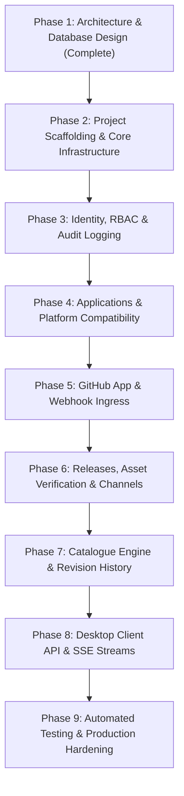

# HENU Platform API - Phased Implementation Plan

**Document Version:** 1.0.0  
**Project:** `henu-platform-api`  
**Author:** Principal Backend Architect, HENU OS PRIVATE LIMITED  

---

## 1. Roadmap Overview

---

## 2. Phase Breakdown & Deliverables

### Phase 1: Architecture & Database Design (Current)
- [x] High-level ecosystem architecture specification (`docs/ARCHITECTURE.md`).
- [x] Complete PostgreSQL database schema and Prisma models (`docs/DATABASE_DESIGN.md`).
- [x] Comprehensive OpenAPI 3.1 REST API specification (`docs/API_SPECIFICATION.md`).
- [x] GitHub App integration, signature verification, and webhook pipeline (`docs/GITHUB_INTEGRATION.md`).
- [x] Threat model and security design document (`docs/SECURITY_DESIGN.md`).
- [x] Phased implementation roadmap (`docs/IMPLEMENTATION_PLAN.md`).

### Phase 2: Project Scaffolding & Core Infrastructure
- **Objectives:** Initialize clean NestJS application structure with strict TypeScript configuration and containerized developer environment.
- **Tasks:**
  - Initialize NestJS project in `henu-platform-api`.
  - Configure strict `tsconfig.json` (`strict: true`, `noImplicitAny: true`).
  - Configure ESLint, Prettier, and Husky git pre-commit hooks.
  - Setup Prisma ORM with PostgreSQL client generator.
  - Create `docker-compose.yml` defining local PostgreSQL 16 database and test instance.
  - Setup `@nestjs/config` with Joi/Zod environment variable schema validation.
  - Implement RFC 7807 global exception filter (`HttpExceptionFilter`).
  - Configure Swagger/OpenAPI documentation generation at `/api/docs`.
- **Definition of Done:** Server compiles cleanly, connects to PostgreSQL, passes health check at `/health/live`, and exposes Swagger UI.

### Phase 3: Identity, Access Control & Audit Subsystem
- **Objectives:** Implement secure administrator authentication, token lifecycle, role-based authorization, and immutable auditing.
- **Tasks:**
  - Seed baseline system roles (`SUPER_ADMIN`, `RELEASE_MANAGER`, `CATALOGUE_EDITOR`, `AUDITOR`) and permissions.
  - Implement Argon2id password hashing utility.
  - Implement `AuthModule` (login, rotating refresh tokens, logout, me).
  - Implement `@RequirePermissions(...)` decorator and `PermissionsGuard`.
  - Implement `AuditInterceptor` capturing all administrative mutations into `AuditLog`.
- **Definition of Done:** Admin can authenticate, receive JWT + refresh token, access permission-gated endpoints, and view recorded audit logs.

### Phase 4: Application & Repository Management
- **Objectives:** Enable dynamic registration of applications and external GitHub repository bindings.
- **Tasks:**
  - Implement `ApplicationsModule` (CRUD operations for applications, categories, and branding).
  - Implement `PlatformCompatibilityModule` (OS, architecture, package format rules).
  - Implement `RepositoryConnectionsModule` (GitHub repo bindings, branch configuration, asset regex).
  - Enforce soft-deletion policies on applications and repository connections.
- **Definition of Done:** Admins can register applications (e.g., HENU PA, HENU AI, HENU IDE) and associate target GitHub repositories and platform compatibility profiles via Admin API.

### Phase 5: GitHub App & Webhook Ingress
- **Objectives:** Deliver secure, idempotent GitHub App webhook ingestion.
- **Tasks:**
  - Implement `GitHubAppService` with Octokit App authentication (RS256 JWT to installation tokens).
  - Configure raw HTTP body preservation in NestJS.
  - Implement constant-time HMAC-SHA256 signature verification guard.
  - Implement `WebhookIngestController` with atomic deduplication via `WebhookEvent.deliveryId`.
  - Setup BullMQ / asynchronous event processor for webhook handling.
- **Definition of Done:** Incoming GitHub release webhooks are verified, de-duplicated, stored, and acknowledged with 200 OK within 500ms.

### Phase 6: Releases, Asset Verification & Channels
- **Objectives:** Classify releases, verify binary assets, enforce platform compatibility, and manage channels.
- **Tasks:**
  - Implement Semver parsing and validation service.
  - Implement `ReleaseChannelsModule` (`STABLE`, `BETA`, `NIGHTLY`).
  - Implement asset classifier (extracting filename, matching regex, detecting package format).
  - Implement SHA-256 verification (parsing `.sha256` companion files or streaming digest calculation).
  - Implement release state machine (`DRAFT` -> `VALIDATED` -> `PUBLISHED` -> `REVOKED`).
  - Implement manual promotion and emergency revocation endpoints.
- **Definition of Done:** Releases from GitHub are automatically parsed, validated against platform compatibility rules, and presented in the Admin Panel for review/promotion.

### Phase 7: Catalogue Engine & Revision History
- **Objectives:** Compile, version, and publish immutable public catalog manifests.
- **Tasks:**
  - Implement `CatalogueBuilderService` aggregating active applications and published releases.
  - Generate deterministic SHA-256 hash over the compiled catalog JSON payload.
  - Implement atomic catalog publication in `CatalogueRevision` table.
  - Implement rollback endpoint restoring a prior revision.
  - Expose `/api/v1/admin/catalogue/preview` for pre-publication inspection.
- **Definition of Done:** Admin can preview prospective catalog changes, publish revision 1, observe incremented revision counters, and verify manifest content hash.

### Phase 8: Desktop Client Hub API & Real-Time SSE
- **Objectives:** Deliver high-performance, cached public endpoints and live update push notifications for HENU HUB Desktop.
- **Tasks:**
  - Implement `/api/v1/hub/catalogue` with HTTP `ETag` and `Cache-Control` headers (handling `304 Not Modified`).
  - Implement `/api/v1/hub/apps/:slug` public application detail endpoint.
  - Implement `/api/v1/hub/updates/check` targeted update checker.
  - Implement Server-Sent Events (SSE) controller for `/api/v1/hub/events/stream` and `/api/v1/admin/events/stream`.
  - Strip all internal identifiers, notes, and database metadata from public DTOs.
- **Definition of Done:** Desktop client can download public catalog, receive 304 on re-queries, check for target updates, and receive real-time push announcements over SSE.

### Phase 9: Automated Testing & Production Hardening
- **Objectives:** Validate end-to-end reliability, security boundaries, and container deployment readiness.
- **Tasks:**
  - Unit tests for all business services (Semver parsing, asset classification, HMAC verification).
  - Integration tests for database queries and Prisma transactions.
  - E2E tests for Webhook ingestion, Release promotion, and Catalog generation using Testcontainers.
  - Configure Helmet security headers, CORS policies, and `@nestjs/throttler` rate limiting.
  - Multi-stage production `Dockerfile` with non-root execution.
  - CI/CD workflow configuration (GitHub Actions linting, testing, and Docker build).
- **Definition of Done:** Test suite achieves >85% code coverage; zero high/critical security findings in vulnerability audit.

